# nis2-gap-check

nis2-gap-check lee una autoevaluación CSV con una fila por control (`measure,status,owner,evidence,last_review`) y la compara con las diez medidas mínimas del artículo 21.2 de NIS2: análisis de riesgos, gestión de incidentes, continuidad de negocio, cadena de suministro, adquisición y desarrollo seguros, evaluación de eficacia, ciberhigiene y formación, criptografía, recursos humanos y control de acceso, y autenticación multifactor. Informa de medidas ausentes, no implantadas, sin responsable, sin evidencia o sin revisión en los últimos 12 meses.



**Demo en vivo:** https://jvch0512.github.io/nis2-gap-check/ (datos sintéticos)

## Uso

```bash
bin/nis2-gap-check examples
bin/nis2-gap-check evaluacion.csv --tsv
bin/nis2-gap-check evaluacion.csv --fail-on high
```

Códigos de salida: 0 correcto, 1 hallazgos iguales o superiores a `--fail-on`, 2 entrada no válida. La salida es texto por defecto y TSV con `--tsv`; también hay SARIF mediante `scripts/tsv2sarif.py`.

| Regla | Severidad | Qué detecta |
|---|---|---|
| NIS001 | alta | una medida del artículo 21.2 no tiene fila en la evaluación |
| NIS002 | alta | estado `not_started` o `no` |
| NIS003 | media | estado `partial` o `in_progress` |
| NIS004 | media | estado `implemented` pero sin evidencia |
| NIS005 | baja | sin responsable nombrado |
| NIS006 | baja | última revisión de más de 12 meses o ausente, con `--today AAAA-MM-DD` o la fecha del sistema |
| NIS007 | media | la fila nombra una medida que no es una de las diez (error tipográfico o control propio) |
| NIS000 | info | fichero vacío o sin cabecera |

## Límites

- Comprueba la autoevaluación, no el entorno real. Un control `implemented` con evidencia se acepta tal cual.
- Las diez claves son fijas: `risk_analysis`, `incident_handling`, `business_continuity`, `supply_chain`, `secure_development`, `effectiveness`, `hygiene_training`, `cryptography`, `hr_access`, `mfa`.
- La transposición nacional difiere. Consulte la norma del Estado miembro aplicable a la entidad.
- Es una lista de brechas para preparación, no asesoramiento jurídico ni un certificado de cumplimiento.

## Dónde encaja

Preparar un taller de preparación a NIS2 o una auditoría: una primera vista rápida de lo que falta antes de llamar a un consultor. Los plazos de notificación del artículo 23 son 24 horas (alerta temprana), 72 horas (notificación) y un mes (informe final).

## Pruebas

```bash
make test
```

## Más información

- Código abierto bajo licencia MIT. Seguridad: [SECURITY.md](SECURITY.md).
- Validación con datos reales: [docs/validation.md](docs/validation.md) (en inglés).
- Versión en inglés: [README.md](README.md).
